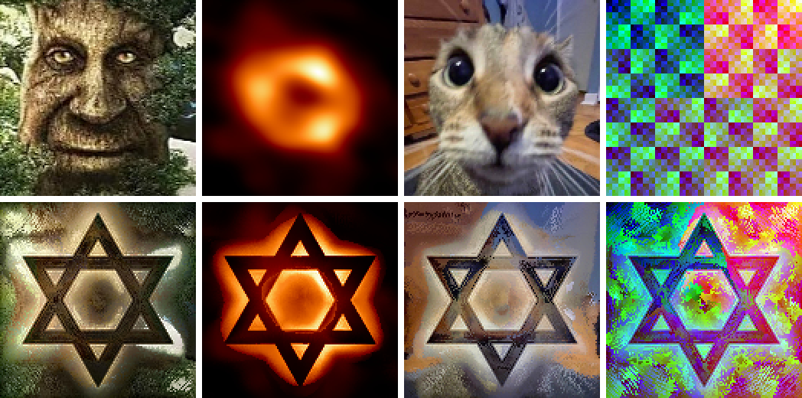

# starify

Turns any image into a Star of David: the pixels of your picture fly apart and
rearrange themselves into the star.

Everything runs in the browser. Images you pick are never uploaded anywhere.

This is a fork of [obamify](https://github.com/Spu7Nix/obamify) by Spu7Nix
(MIT licensed), with the target picture swapped and the interface trimmed to
that one job.

# How to use

Use the bar at the top to replay the animation, play it in reverse, save it as
a gif, switch between saved transformations, and make a new one from your own
image. When making a new one you can crop and zoom your image; the small
overlap preview shows how it lines up with the star.

Advanced settings:

| Setting              | Description |
|----------------------|-------------|
| resolution           | How many cells the image is divided into. Higher is sharper and slower. |
| proximity importance | How strongly pixels prefer to stay near where they started. Lower gives a crisper star, higher keeps more of the original picture visible. |
| algorithm            | "fast" is the default. "optimal" finds the mathematically best arrangement but is extremely slow at high resolutions. |

# Running it

1. Install [Rust](https://www.rust-lang.org/tools/install)
2. `rustup target add wasm32-unknown-unknown`
3. `cargo install --locked trunk`
4. `trunk serve --release --open`

`trunk build --release` writes the finished static site to `dist/`; host that
folder anywhere. `.github/workflows/gh_pages.yml` does this on every push to
`main` and publishes to GitHub Pages.

There is also a desktop build: `cargo run --release`.

# How it works

The image is cut into a grid of cells. Every cell of the target star is
assigned one cell of your image so that, overall, colours match the star as
well as possible while cells travel as little as possible. The cost of putting
a source cell on a target cell is

    colour difference² × weight + (distance² × proximity importance)²

`weight` comes from a second image, the weight map: it is high on and around
the star, where the shape has to read clearly, and low in the background, where
the original picture is allowed to show through.

The animation is a particle simulation that pulls each cell to its assigned
place while cells push each other apart.

# Changing the star

`tools/make_target.py` draws the target, the weight map and the app icons
(needs Python with Pillow and numpy). Shape, colours and weights are constants
at the top of the file.

    python3 tools/make_target.py

The bundled presets store assignments that were computed for one specific
target, so re-bake them afterwards:

    cargo run --release --example make_preset -- presets/cat/source.png cat

# License

MIT, see [LICENSE](LICENSE). Original work © Spu7Nix.
